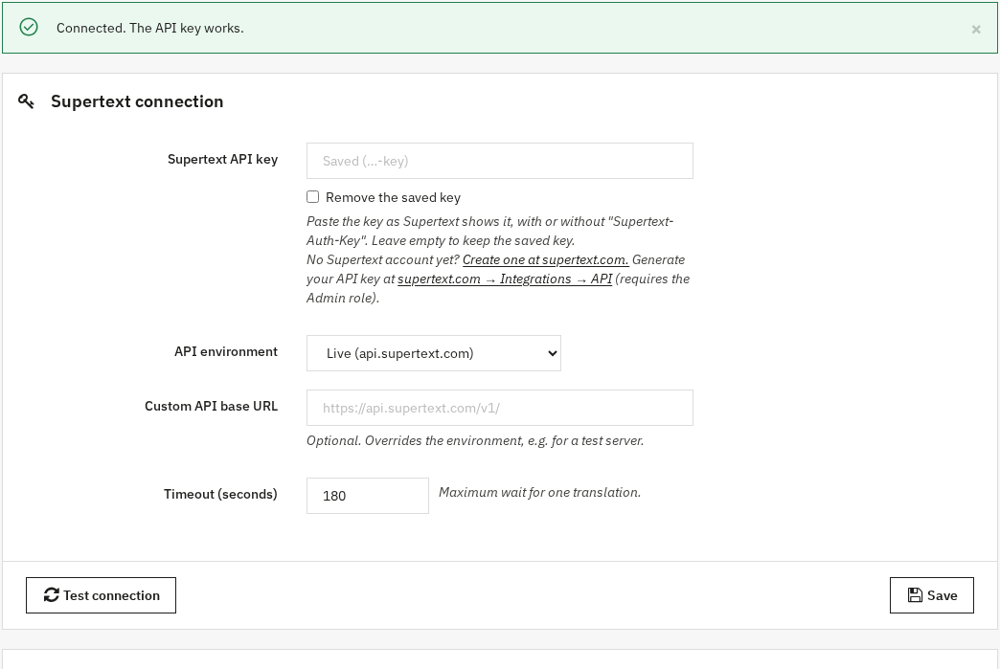
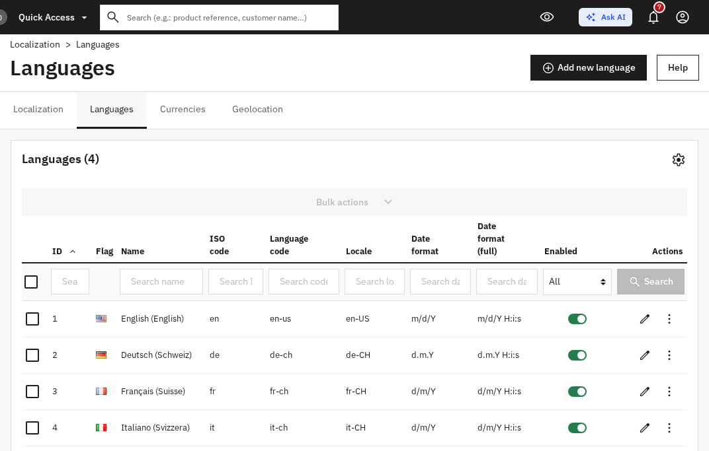
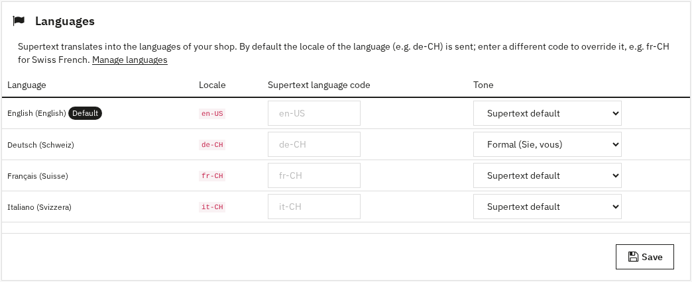

# Installation guide — Supertext Translation for PrestaShop

For administrators setting up the module in a PrestaShop shop.

## Just want to try it?

A ready-to-run container with PrestaShop 9, English sample products, a category and a CMS page, German (Switzerland), French (Switzerland) and Italian (Switzerland), and this module is in `demo/`. It is also what runs the public Supertext demo. See the *Demo* section of the [developer guide](DEVELOPER.md#demo-railway).

## Requirements

| | |
| --- | --- |
| PrestaShop | 9.x (tested with 9.2), 8.1 and 8.2 (supported, not yet tested) |
| PHP | 8.1 or later (whatever your PrestaShop version needs), with `ext-dom` and `ext-curl` |
| Shop setup | At least two languages (step 3) |
| Supertext | An account with an API key, see [Get a Supertext account and API key](#get-a-supertext-account-and-api-key) |
| Network | The web server must reach `https://api.supertext.com` over HTTPS (and, for [Translation review](#translation-review), Supertext's review service) |

## 1. Install the module

The module isn't on PrestaShop Addons yet. Download `supertext-<version>.zip` from the [Releases page](https://github.com/Supertext/PrestaShop-Supertext-Translation/releases), or build it from this repository:

```bash
./build.sh            # creates dist/supertext-<version>.zip
```

Then in the back office: *Modules → Module Manager → Upload a module* and drop the zip. PrestaShop installs it right away. On the command line, unzip it into `modules/` and run:

```bash
php bin/console prestashop:module install supertext
```

## 2. Set the API key

### Get a Supertext account and API key

1. **Account:** no Supertext account yet? [Log in or create one](https://www.supertext.com/person/en/account/signin) with your email address.
2. **API key:** generate it at [supertext.com → Integrations → API](https://www.supertext.com/en/integrations/api). Only users with the **Admin** role in the Supertext account can do this; otherwise ask your Supertext account admin for a key.

The module settings link to both pages, next to the API key field.

### Enter it in PrestaShop

*Modules → Module Manager*, search for **Supertext Translation** and click **Configure**:

1. Paste your key into **Supertext API key** and click **Save**. You can paste it exactly as Supertext shows it, with the leading `Supertext-Auth-Key`, or without it. The field stays empty afterwards and shows the key's last characters; leave it empty to keep the saved key.
2. Saving checks the key right away (Supertext's cost-free `features` call; nothing is translated or billed). *API key checked: the connection to Supertext works.* means everything is in place. **Test connection** runs the same check again at any time. The latest result stays visible under **API key check**, with the time it was checked.



On servers you can set the key as the environment variable **`SUPERTEXT_API_KEY`** instead. It takes precedence over the field, keeps the key out of the database, and the settings page then says that the environment variable is used.

## 3. Set up the languages

The module translates into your shop's **languages**: every product, category and CMS page has its own name, descriptions and URL in each of them.

1. Add the languages you need: *International → Localization → Languages → Add new language*, or import a localization pack under *International → Localization*.
2. Make sure they are **enabled**, so customers see them.



When you add a language, PrestaShop copies the default language's texts into it. The module treats a text that is still identical to the source language as *not translated* and fills it.

### Supertext language and tone

Each shop language needs a **Supertext language**. Supertext accepts exactly these target codes (from its `features` list, October 2026):

| Language | Supertext codes |
| --- | --- |
| German, English, French, Italian, Portuguese | `de-DE`, `de-CH`, `de-AT`, `en-US`, `en-GB`, `fr-FR`, `fr-CH`, `it-IT`, `it-CH`, `pt-PT`, `pt-BR` |
| Chinese, Serbian | `zh-Hans`, `zh-Hant`, `sr-Latn`, `sr-Cyrl` |
| Swiss German | `gsw-u-sd-chzh` (Zurich), `gsw-u-sd-chbe` (Bern) |
| All others, without region | `bg`, `cs`, `da`, `el`, `es`, `fi`, `hr`, `hu`, `ja`, `ko`, `nb`, `nl`, `pl`, `rm`, `ru`, `sk`, `sl`, `sq`, `sv`, `tr` |

In the module settings (*Modules → Module Manager → Supertext Translation → Configure*), the **Languages** panel has one row per shop language (all of them, including the default language, because the same choice is used when a language is the source) with:

- the **Supertext language**: a list of Supertext's codes, shown as name and code (*Deutsch (Schweiz) (de-CH)*, names in your back-office language). A language that has none saved yet gets a suggestion preselected:
  - its **locale** when that already is one of these codes (apart from upper/lower case and `_`/`-`: `de-CH`, `fr-CH`, `es`);
  - otherwise the usual code where one is obvious (the Supertext SDK's defaults, the same in every Supertext plugin):

    | Shop locale | Suggested Supertext language |
    | --- | --- |
    | `de`, `en`, `fr`, `it`, `pt` | `de-DE`, `en-US`, `fr-FR`, `it-IT`, `pt-PT` |
    | `zh`, `zh-CN`, `zh-SG` / `zh-TW`, `zh-HK`, `zh-MO` | `zh-Hans` / `zh-Hant` |
    | `sr`, `sr-Latn-RS` | `sr-Latn` |
    | A region of a language Supertext offers without region (`es-ES`, `es-MX`, `nl-NL`, `sl-SI`, `nb-NO`) | the bare code (`es`, `nl`, `sl`, `nb`) |

  - nothing else is guessed: `en-IE`, `de-LI`, `fr-BE`, `sr-RS`, `gsw` or `no` show *— choose —* and the hint *No suggestion for this language*. Such a language can't be ticked on the *Translate with Supertext* page and nothing is sent for it until you choose its Supertext language.

  **Save** to store the choices. A language you never saved uses its suggestion anyway, so a shop with `de-CH`, `fr-CH` and `de` translates without any setup; save once to fix the choice (for example `de` as `de-CH` instead of `de-DE`). When the language is the source, only its language is sent (`de-CH` → `de`, `en-US` → `en`). Saving accepts only codes from the list.
- the **tone**: *Formal (Sie, vous)*, *Informal (du, tu)* or *Supertext default*. It is only shown when the chosen Supertext language offers it; English, Swiss German, Romansh, Albanian and Serbian have none (the panel says *Supertext offers no formal/informal choice for this language*, and a tone saved earlier for them isn't sent).
- **Translation review**: on or off (off by default), see [Translation review](#translation-review).

**Upgrading from 0.1.0**, where the Supertext language was a free-text field: saved codes are read as codes of the list (`de-ch` → `de-CH`, `de` → `de-DE`, which is what 0.1.0 sent, `es-ES` → `es`) and stored that way the next time the settings page is opened. A saved code the list doesn't know (for example one Supertext added later) stays selected and is sent as it is.



(The screenshot doesn't show the *Translation review* column yet.)

### Translation review

With **Translation review**, people check the translations on the shop's website itself and correct them there: customers or Supertext linguists open the original and the translated page side by side in Chrome with the *Supertext Localization Review* extension and fix texts in a side panel. Their corrections come back into PrestaShop.

Turn it on per language in the module settings (*Modules → Module Manager → Supertext Translation → Configure → Languages*): tick **Translation review** in the row of the language that is translated **into** (e.g. *Deutsch (Schweiz)*) and **Save**. Untick it to turn it off again; nothing else changes.

- Translations into that language then go through Supertext's review service instead of directly to Supertext. It answers exactly like Supertext and passes everything on with your API key, so billing, languages, tone and error messages stay the same.
- The review service keeps every translation of your account. A text it has translated before gets the same translation again (without a new Supertext call), and once a reviewer has corrected it, the corrected text.
- **Corrections arrive with the next translation:** after a review, translate the products, categories or pages into that language again (*Translate with Supertext*, with *Overwrite existing translations* ticked) to write the corrections into PrestaShop. As always, overwriting replaces manual changes in the translated fields.
- Reviewers get a review link for your shop from Supertext; nothing to set up in PrestaShop.
- The review service works with keys of the **live** Supertext API. With the *Staging* or *Testing* environment (or a custom API base URL), leave review off.
- *Export for translation* and *Import translation* don't use the review service. The API key check (and *Test connection*) still goes directly to Supertext.
- **Review service URL** in the *Supertext connection* panel is the review service's address; it defaults to Supertext's review service (`https://localizationreview-production.up.railway.app/v1/`). Only change it when Supertext gives you another address. Empty turns Translation review off for every language. The environment variable `SUPERTEXT_REVIEW_URL` wins over the field.

## 4. Check it works

Open *Catalog → Products*, tick a product and choose **Translate with Supertext** in the **Bulk actions** (see the [user guide](USER_GUIDE.md)). Or from the command line:

```bash
php bin/console supertext:translate product <id> [<id>…] [--to=de --to=fr] [--from=en] [--overwrite]
php bin/console supertext:translate category <id>
php bin/console supertext:translate cms <id>
```

## Who can translate

Employees whose profile may **edit** the item: *Catalog → Products* for products, *Catalog → Categories* for categories, *Design → Pages* for CMS pages (*Advanced Parameters → Team → Permissions*, "Edit"). PrestaShop's **Translator** profile can translate products and categories out of the box; give it *Design → Pages* (view and edit) if it should translate CMS pages too.

The **Translate with Supertext** button on the product page (*Modules* tab) is shown to profiles with **view** permission on the module. Installing the module grants it to every profile; you can change that under *Advanced Parameters → Team → Permissions → Modules*. Only SuperAdmins can configure the module.

### Export for translation and import

The *Export for translation* and *Import translation* boxes on the *Translate with Supertext* page need the same permission as translating: **edit** on the item's list (products, categories or pages); an import is refused for items the employee may not edit. They don't need an API key and have nothing to configure. Uploaded files are limited to **10 MB** (PHP's own `upload_max_filesize` and `post_max_size` must allow that much if you want the full limit); they are read in memory and never stored on the server.

## Interface languages

The module's screens (settings page, *Translate with Supertext* page, list actions, product page box and messages) are available in English, German, French and Italian. They follow the employee's back-office language: each employee chooses it under *Your profile* (avatar at the top right → *Your profile* → *Language*). The translations ship with the module (`supertext/translations/<locale>/`) for de-DE, de-AT, de-CH, fr-FR, fr-BE, fr-CA, fr-CH, it-IT and it-CH; other locales show English. Wordings changed under *International → Translations* (*Installed modules translations*, module *Supertext Translation*) take precedence.

## All settings

| Setting | Default | Purpose |
| --- | --- | --- |
| Supertext API key | – | Your key, with or without the `Supertext-Auth-Key` prefix. The `SUPERTEXT_API_KEY` environment variable wins. |
| API environment | Live | `Live` (api.supertext.com), `Staging` or `Testing` Supertext API |
| Custom API base URL | – | Overrides the environment (e.g. a test server). The `SUPERTEXT_API_ENDPOINT` environment variable wins. |
| Review service URL | Supertext's review service | Address of the review service for languages with *Translation review* on (see [Translation review](#translation-review)). Empty turns review off for every language. The `SUPERTEXT_REVIEW_URL` environment variable wins. |
| Timeout | 180 s | Maximum wait for one translation (30–1800 s) |
| Send version information to Supertext | On | Sends the site URL and the versions of this module, PrestaShop and PHP to Supertext when you save the settings and after an update (see [below](#version-information-and-the-api-key-check)). The `SUPERTEXT_VERSION_REPORTS` environment variable wins (`0`, `false`, `off`, `no` or `1`, `true`, `on`, `yes`). |
| Languages | suggested per locale | Per shop language: its Supertext language (a list; the suggestion is preselected and used until you save another one, see [Supertext language and tone](#supertext-language-and-tone)), tone (only where Supertext offers one) and *Translation review* (off; see [Translation review](#translation-review)). Languages saved by an earlier version have review off. |

Settings are global (the same for all shops of a multistore installation).

## Version information and the API key check

**Send version information to Supertext** is on by default. The module then tells Supertext which versions you run, so Supertext support can help you faster: when you save the module settings, and when a back-office page of the module (settings, *Translate with Supertext*, a translation, the `supertext:translate` command) notices that the module, PrestaShop or PHP was updated or that the result of the API key check changed. A report contains exactly:

- the shop's URL (the default shop's domain and base URI, as PrestaShop knows it),
- the module's name and version, the PrestaShop version, the PHP version and the version of the bundled Supertext SDK,
- whether an API key is set and the result of the latest API key check (status, time, HTTP status, Supertext's error code),
- the address of the ping endpoint below.

**No content, no API key and no personal data are sent.** Reports go from your server, never from the browser; a report takes at most 3 seconds, a failed one is not tried again for an hour, and reporting never slows down or breaks saving or translating (where PHP runs as PHP-FPM, it happens after the page has been sent). To turn it off, untick the setting and save, or set the environment variable `SUPERTEXT_VERSION_REPORTS=0` on the server (it wins over the setting, and the settings page says so). Then nothing is sent at all, and the ping endpoint answers 404.

**The API key check** runs whether or not version information is sent: when you save the settings, on **Test connection**, when a back-office page of the module runs with a key that hasn't been checked yet (e.g. a new `SUPERTEXT_API_KEY`; the module compares a fingerprint of the key, never stores the key itself for this), and when Supertext rejects the key during a translation. It's Supertext's cost-free `features` call. The settings page shows the latest result with its time:

| Result | Message |
| --- | --- |
| ok | *API key checked: the connection to Supertext works.* |
| invalid | *Supertext rejected the API key. …* (with the links to generate a key and to create an account) |
| missing | *No API key is set yet. …* (with the same links) |
| unreachable | *The API key couldn't be checked because Supertext can't be reached. …* |
| error | *The API key couldn't be checked: Supertext answered with an error (…).* |

**The ping endpoint** `https://<your shop>/index.php?fc=module&module=supertext&controller=ping&challenge=…` is public (no login) and answers only `{"ok":true,"plugin":"PrestaShop-Supertext-Translation","challenge":"…"}`, so Supertext can see that the shop is reachable from the internet. It returns nothing else: no versions, no settings, no data, and it skips PrestaShop's storefront (no cookie, cart, maintenance page or redirect). If a firewall or a full-page cache sits in front of the shop, let this URL through uncached.

The module keeps this state (what was reported last, the latest key check, the key's fingerprint) in the configuration value `SUPERTEXT_REPORTER_STATE`; uninstalling removes it.

## Updating

Upload the new zip in *Modules → Module Manager → Upload a module* (or replace `modules/supertext/` and run `php bin/console prestashop:module upgrade supertext`). Settings are kept.

## Uninstalling

*Modules → Module Manager*, **Supertext Translation** → **Uninstall**. This removes the module's settings; translations made so far stay in your shop.

## Troubleshooting

| Message | Cause / fix |
| --- | --- |
| *Supertext is not set up yet* | No API key: enter it in the module settings (step 2), or set `SUPERTEXT_API_KEY`. |
| *Authentication failed* / *Supertext rejected the API key* | The key is wrong or revoked. Check that you copied the whole key and run **Test connection**; if needed, generate a new one at [supertext.com → Integrations → API](https://www.supertext.com/en/integrations/api) (Admin role required). No Supertext account yet? [Create one at supertext.com](https://www.supertext.com/person/en/account/signin). |
| *The API key couldn't be checked because Supertext can't be reached* | The server can't reach `api.supertext.com` (firewall, proxy, DNS). Translations need the same connection. |
| *The API key couldn't be checked: Supertext answered with an error (…)* | Usually temporary; run **Test connection** again later. If it stays, contact Supertext with the code shown. |
| *You are not allowed to edit this item* | The employee's profile lacks *Edit* permission (see *Who can translate*). |
| *The translation could not be saved: …* | PrestaShop rejected a translated value (e.g. a field it validates strictly). The message names the field; translate it by hand or report it to Supertext. |
| *The language … has no Supertext language* / *No suggestion for this language* in the Languages panel | The language's locale is neither a Supertext code nor one with an obvious default (e.g. `en-IE`, `de-LI`, `gsw`). Choose its Supertext language in *Configure → Languages* (see [Supertext language and tone](#supertext-language-and-tone)). |
| *Supertext does not support this language pair (en → xx-YY)* | A saved Supertext language that Supertext doesn't offer, or the same language as the source. Choose another one from the list; the message shows the codes that were sent. |
| *Supertext offers no formal or informal tone for this language* | The language's tone is *Formal* or *Informal*, but Supertext doesn't offer that for its Supertext language. The module only sends a tone where Supertext's list offers one, so this only happens with a code that isn't in the list; set the tone to *Supertext default*. |
| *Authentication failed* only for languages with *Translation review* | The review service only works with keys of the live Supertext API: with the *Staging* or *Testing* environment (or a custom API base URL) leave review off. |
| Reviewers' corrections don't show up in PrestaShop | They arrive with the next translation: translate the items into that language again with *Overwrite existing translations*. Check that the language's *Translation review* is ticked and that *Review service URL* isn't empty. |
| *Too many requests to Supertext* | Supertext's per-second limit was still exceeded after 4 automatic retries. Wait a moment and translate again. |
| *Your Supertext translation limit is exceeded* | Your Supertext plan's volume is used up. |
| *Timed out waiting* | Very long descriptions: raise the *Timeout* (and PHP's `max_execution_time`). |
| *Could not reach Supertext* | The server can't make outbound HTTPS calls; check the firewall or proxy (`HTTPS_PROXY`). |
| No **Translate with Supertext** in the bulk actions | The module is disabled, or the list is a custom one. Clear the cache (*Advanced Parameters → Performance → Clear cache*). |
| No button in the product page's *Modules* tab | The employee's profile has no *view* permission on the module (see *Who can translate*). |

Failed translations are also written to *Advanced Parameters → Logs*.

## Security notes

- Imported translation files are treated as untrusted input: at most 10 MB, no DTDs or entities, and the formatting written back can only be the formatting of the current source text (the Supertext SDK checks every segment).

- Prefer the `SUPERTEXT_API_KEY` environment variable on servers: the key then never sits in the database or its backups.
- The module only talks to the Supertext API you configured (and, for languages with *Translation review* on, the review service). Documents are deleted from Supertext right after download (and expire after 24 hours anyway).
